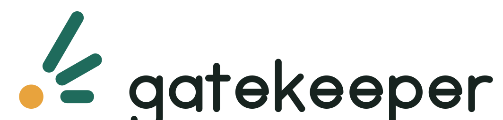

# GateKeeper logo: usage guide

## The idea

**Lift.** The gate's lifting arm drawn as three rising signal bars around one pivot. The **amber dot** is you and the call; the **green bars** are the arm rising one step at a time. Calling and opening, in one shape.

## Files (`design/logo/kit/`)

| File | Use |
|---|---|
| `symbol-color.svg` | Default mark on light backgrounds |
| `symbol-reversed.svg` | Mark on green or dark backgrounds (cream bars, amber dot) |
| `symbol-black.svg` | One-colour (print, engraving, fax-grade) |
| `symbol-small-*.svg` | **Small-size cut** for 32 px and below: heavier bars, wider gaps |
| `app-icon.svg` / `app-icon-small.svg` | Rounded-square tile; the small cut is used for favicons |
| `app-icon-square.svg`, `app-icon-maskable.svg` | Full-bleed (Apple touch) and PWA maskable versions |
| `lockup-horizontal-color.svg` | Symbol + wordmark, default |
| `lockup-horizontal-reversed.svg` | On brand green |
| `lockup-horizontal-black.svg` | One-colour |
| `lockup-stacked-color.svg` | Square-ish spaces (splash, social avatars) |
| `wordmark-black.svg` | Custom lowercase wordmark on its own |

PNG exports are in `png/` (1024 px) and the web icon set is in `web/`. The Android launcher (adaptive and monochrome) and notification icons are written straight into `android/app/src/main/res/` by the generator.

**Everything is generated by [`build_kit.py`](build_kit.py)** from one set of construction values. Change the geometry there and re-run `python design/logo/build_kit.py`; never edit the outputs by hand. The Flutter `GateKeeperMark` widget (`lib/src/ui/logo.dart`) mirrors the same numbers.

## Colour

| Role | HEX | RGB | Notes |
|---|---|---|---|
| Gate green (primary) | `#1F6B5C` | 31 107 92 | Bars, tiles, theme seed |
| Signal amber (accent) | `#E8A33D` | 232 163 61 | The dot only; never for text |
| Cream | `#F3EFE4` | 243 239 228 | Bars and wordmark on green |
| Ink | `#17231F` | 23 35 31 | Wordmark on light backgrounds |

Cream on green has a 5.5:1 contrast ratio and ink on cream 14.1:1 (both pass WCAG AA for text). Amber on green is 2.9:1, which is fine for a graphic dot but never for text. Amber is decorative; it only ever appears as the dot.

## Construction

- Pivot dot radius 26; bars 28 wide with round caps; bars start 76 from the pivot centre at **0°, 30° and 60°**; bar lengths 44 / 82 / 120.
- Small cut: dot 32, bars 36 wide, start 90, lengths 24 / 54 / 84 (same angles).
- Wordmark: custom lowercase monoline, stroke 20 on an x-height of 100, bowls of radius 40, the same round caps as the bars. In the horizontal lockup the x-height is 0.34 × the symbol height and the baseline sits on the bottom of the dot.

## Clear space and minimum size

- **Clear space:** at least the dot's diameter on every side of the symbol or lockup.
- **Minimum size:** symbol 24 px (use the small cut at 32 px and below, down to 16 px); horizontal lockup 120 px wide; wordmark x-height 8 px.

## Backgrounds

- Light (white, cream): `symbol-color` / `lockup-horizontal-color`.
- Brand green or any dark colour: the reversed versions.
- Photos: use the one-colour version in white or black, whichever has more contrast, or place the app-icon tile.

## Don't

- Recolour the dot green or the bars amber; use more than the palette.
- Change the bar angles, spacing or count, or add a fourth bar.
- Rotate, flip, outline, add shadows or gradients, or stretch.
- Set the name in another typeface next to the symbol; use the provided lockups.
- Use the regular cut below 32 px (the gaps close), or put the colour mark on busy photos.

## Notes

- The wordmark is lowercase "gatekeeper" by design. In running text the product name stays **GateKeeper**.
- No fonts were used: every letter is constructed geometry, so there's no font licence to worry about.
- Not trademark-cleared. Run a professional search before wider commercial use.
